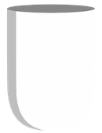

# Ceramic

**Ceramic** is a cross-platform 2D framework written in Haxe that can export natively to:

- **Desktop** (windows, mac, linux)
- **Mobile** (ios, android), web (js + webgl)
- **Unity** projects

## Examples and Documentation

https://ceramic-engine.com

## Credits

Ceramic was created by **[Jérémy Faivre](https://github.com/jeremyfa)**, as well as multiple libraries used internally, but is also possible thanks to the following works:

* **[Luxe Engine (alpha)](https://luxeengine.com/alpha/) by ruby0x1** which was used as a transitional backend before `clay` backend was ready. Some snippets of Ceramic still directly come from `luxe`.

* **[HaxeFlixel's FlxColor class](https://github.com/HaxeFlixel/flixel/blob/a59545015a65a42b8f24b08262ac80de020deb37/flixel/util/FlxColor.hx) by Joe Williamson** which was ported into  to `ceramic.Color` and `ceramic.AlphaColor` classes.

* **[OpenFL](https://github.com/openfl/openfl/blob/0b84012052fc8f6ab2e211c93769c99ad331beb9/openfl/geom/Matrix.hx) by Joshua Granick** and **[PixiJS](https://github.com/pixijs/pixi.js/blob/85aaea595f77bf0511886c499fc2733d4f5ba524/src/core/math/Matrix.js) by Mathew Groves** to implement `ceramic.Transform` class.

* **[Haxe](https://haxe.org/) by Nicolas Cannasse**, maintained by the **Haxe Foundation**, which is a fantastic cross-platform toolkit and programming language making it much easier to create a portable engine.

* **[Node.js](https://nodejs.org/) and its huge amount of community supported modules**, helping a lot to create feature-complete and cross-platform command line tools.

* **[Janicek Core Haxe](https://github.com/rjanicek/janicek-core-haxe) by Richard Janicek**, for some borrowed code for `ceramic.Utils.hashCode()`.

* **[Slugify](https://github.com/simov/slugify) by Simov**, and **[Slug haxelib port](https://lib.haxe.org/p/slug)** to provide `ceramic.Slug`.

* **[HaxeFlixel's FlxEmitter class](https://github.com/HaxeFlixel/flixel/blob/02e2d18158761d0d508a06126daef2487aa7373c/flixel/effects/particles/FlxEmitter.hx)** used as a starting point to implement `ceramic.Particles` and `ceramic.ParticleEmitter`.

* **[Optimised HashMaps](https://github.com/mikvor/hashmapTest) by Mikhail Vorontsov** to implement `ceramic.IntIntMap` and related on static targets.

* **[Some crash logging snippets](https://github.com/larsiusprime/crashdumper/blob/24e28e8fd664de922bd480502efe596665d905b8/crashdumper/CrashDumper.hx) by Lars Doucet** to handle errors with `ceramic.Errors`.

* **[Cardinal Spline JS](https://github.com/gdenisov/cardinal-spline-js) by Gleb Denisov**, used to create `ceramic.CardinalSpline`.

* **[Nuclear Blaze's GameBase Camera](https://github.com/deepnight/ld48-NuclearBlaze/blob/master/src/game/gm/Camera.hx) by Sébastien Bénard**, used as a model to create `ceramic.Camera`.

* **[Bezier Easing](https://github.com/gre/bezier-easing) by Gaëtan Renaudeau**, used to create `ceramic.BezierEasing`.

* **[Some GLSL shader code](https://github.com/kiwipxl/GLSL-shaders) by Richman Steward**.

* **[Some browser mess handling](https://github.com/goldfire/howler.js/blob/143ae442386c7b42d91a007d0b1f1695528abe64/src/howler.core.js#L245-L293) from Howler.js** to help implement Ceramic audio backend for web.

* **[Heaps Aseprite](https://github.com/AustinEast/heaps-aseprite) by Austin East**, from which several snippets were ported for make Ceramic `ase` format parsing and rendering.

* **[Aseprite Blend Functions](https://github.com/aseprite/aseprite/blob/23557a190b4f5ab46c9b3ddb19146a7dcfb9dd82/src/doc/blend_funcs.cpp) by Igara Studio S.A. and David Capello**, which were ported to Haxe in order to implement ase frame blending at runtime in Ceramic.

* **[Extrude Polyline](https://github.com/mattdesl/extrude-polyline) by Matt DesLauriers**, via Haxe port used in Ceramic to draw lines.

* **[LibGDX](https://github.com/libgdx/libgdx)**, used as a reference for polygon triangulation.

* **[Haxe Format Tiled](https://github.com/Yanrishatum/haxe-format-tiled) by Pavel Alexandrov** to parse Tiled Map Editor's TMX format.

* **[Akifox Async HTTP](https://github.com/yupswing/akifox-asynchttp) by Simone Cingano**, used to implement HTTP backend on native targets.

* **[Nape Physics](https://joecreates.github.io/napephys) by Luca Deltodesco and contributors**.

* **[HSLuv](https://github.com/hsluv/hsluv)** to provide additional color manipulation helpers to `ceramic.Color` and `ceramic.AlphaColor`.

* **[Dear ImGui](https://github.com/ocornut/imgui) by Omar Cornut**, via **[Haxe bindings](https://github.com/jeremyfa/imgui-hx) initially created by Aidan Lee**.

* **[Gif Capture](https://github.com/snowkit/gif) ported by Tilman Schmidt and Sven Bergström** from [Moments](https://github.com/Chman/Moments).

* **[Linc RTMidi](https://github.com/KeyMaster-/linc_rtmidi) by Tilman Schmidt**.

* **[Rectangle Bin Packing](https://github.com/Tw1ddle/Rectangle-Bin-Packing) by Sam Twidale**, used for `ceramic.TextureAtlasPacker`.

* **[Ase format parser](https://github.com/miriti/ase) by Michael Miriti** to read `.ase`/`.aseprite` files.

* **[Fuzzaldrin](https://github.com/atom/fuzzaldrin) from Atom** to provide some auto-completion features at runtime debug UI.

* **[SoLoud](https://github.com/jarikomppa/soloud) by Jari Komppa** to implement audio on both C++/Native targets and C#/Unity audio mixing (via MiniLoud port)

* **[LDtk](https://github.com/deepnight/ldtk) by Sébastien Bénard**, a modern 2D level editor, compatible with Ceramic

* **[GPUI](https://github.com/zed-industries/zed/tree/main/crates/gpui) by Zed Industries**, the UI framework of the Zed editor (gpui-pre 0.3.10, Apache-2.0), ported to Haxe as the `glaze` plugin, with its examples (`samples/gpui-examples`) and the text contrast code GPUI adapted from **[Windows Terminal](https://github.com/microsoft/terminal) by Microsoft** (MIT).

* **[GPUI Kit](https://github.com/longbridge/gpui-kit) by Longbridge** (gpui-component and gpui-base 0.8.1, Apache-2.0), ported to Haxe as `glaze.kit`, with its themes (which adapt the color schemes listed in `plugins/glaze/assets/themes/LICENSE.md`) and its story gallery (`samples/story`).

* **[rust-i18n](https://github.com/longbridge/rust-i18n) by Longbridge** (MIT), ported for the locale lookup of `glaze.kit`.

* **[Taffy](https://github.com/DioxusLabs/taffy) by Visly Inc. and the Taffy Authors** (MIT), ported to Haxe as the `taffy` library, the layout engine of `glaze`.

* **[lyon](https://github.com/nical/lyon) by Nicolas Silva** (MIT OR Apache-2.0, used under MIT), adapted for the path building and tessellation of `glaze`, with parts of **[euclid](https://github.com/servo/euclid) by the Servo Project Developers** (MIT OR Apache-2.0, used under MIT).

* **[etagere](https://github.com/nical/etagere) by Nicolas Silva** (MIT OR Apache-2.0, used under MIT), ported for the glyph atlas allocator of `glaze`.

* **[unicode-properties](https://github.com/unicode-rs/unicode-properties) and [unicode-script](https://github.com/unicode-rs/unicode-script) by The Rust Project Developers** (MIT OR Apache-2.0), whose Unicode tables are used by the Canvas2D font fallback of `glaze` on the web.

* **[Ropey](https://github.com/cessen/ropey) by Nathan Vegdahl** (MIT OR Apache-2.0, with parts of str_indices), ported to Haxe as the `ropey` library, the text buffer of the `glaze.kit` inputs and editor.

* **[unicode-segmentation](https://github.com/unicode-rs/unicode-segmentation) by The Rust Project Developers** (MIT OR Apache-2.0) and **[unicode-linebreak](https://github.com/axelf4/unicode-linebreak) by Axel Forsman** (Apache-2.0), ported to Haxe as the libraries of the same names, with tables from the **[Unicode Character Database](https://www.unicode.org/ucd/)** (Unicode License v3).

* **[similar](https://github.com/mitsuhiko/similar) by Armin Ronacher** (Apache-2.0), ported to Haxe as the `similar` library, the diff engine of the `glaze.kit` editor.

* **[html5ever](https://github.com/servo/html5ever) by The html5ever Project Developers (Servo)** (MIT OR Apache-2.0, with parts of tendril and utf-8), ported to Haxe as the `html5ever` library, the HTML parser of the `glaze.kit` rich text.

* **[markdown-rs](https://github.com/wooorm/markdown-rs) by Titus Wormer** (MIT, with the tables of unicode-id), ported to Haxe as the `markdown` library, the Markdown parser of the `glaze.kit` rich text.

* **[data-url](https://github.com/servo/rust-url/tree/main/data-url) by The rust-url developers** (MIT OR Apache-2.0, used under MIT, with fixtures of the **[web-platform-tests](https://github.com/web-platform-tests/wpt)** project, BSD-3-Clause) and **[html5minify](https://github.com/martingallagher/html5minify) by Martin Gallagher** (MIT), ported for the `glaze.kit` rich text.

* **[lsp-types](https://github.com/gluon-lang/lsp-types) by Markus Westerlind** (MIT), ported for the LSP data types of the `glaze.kit` editor.

* **[chrono](https://github.com/chronotope/chrono) by Kang Seonghoon and contributors** (MIT OR Apache-2.0, used under MIT), ported for the dates and times of `glaze.kit`.

* **[serde_json](https://github.com/serde-rs/json) by David Tolnay** (MIT OR Apache-2.0, used under MIT), ported for the JSON style editor of the `glaze.kit` inspector.

* **[fake](https://github.com/cksac/fake-rs) by cksac** (MIT OR Apache-2.0, used under MIT), ported for the generated data of the `glaze` story gallery.

* **[Oniguruma](https://github.com/kkos/oniguruma) by K. Kosako** (BSD-2-Clause), ported to Haxe as the `oniguruma` library with the API of **[vscode-oniguruma](https://github.com/microsoft/vscode-oniguruma) by Microsoft** (MIT), whose `onig.wasm` build `glaze` can also use on the web.

* **[vscode-textmate](https://github.com/microsoft/vscode-textmate) by Microsoft** (MIT), ported to Haxe as the `textmate` library, with the TextMate grammars of **[tm-grammars](https://github.com/shikijs/textmate-grammars-themes) (shiki)**, each under the license of its origin (`plugins/glaze/assets/glaze/grammars`), for the code highlighting of `glaze.kit`.

* **[lunasvg](https://github.com/sammycage/lunasvg) and [plutovg](https://github.com/sammycage/plutovg) by Samuel Ugochukwu** (MIT, plutovg includes code derived from **[FreeType](https://freetype.org)**), ported to Haxe as the `lunasvg` and `plutovg` libraries, used by the `vector` and `ttf` plugins and by `glaze`.

* **[zeno](https://github.com/dfrg/zeno) by Chad Brokaw** (MIT OR Apache-2.0), whose scan converter is ported in the `ttf` library.

* **[Inter](https://github.com/rsms/inter) by The Inter Project Authors** and **[JetBrains Mono](https://github.com/JetBrains/JetBrainsMono) by The JetBrains Mono Project Authors** (SIL Open Font License 1.1), the fonts bundled with `glaze`, and **[Noto Color Emoji](https://github.com/googlefonts/noto-emoji) by Google** (SIL Open Font License 1.1 for the font, Apache-2.0 for the images, public domain flags of region-flags), its optional emoji font.

* **[Lucide](https://lucide.dev) icons by the Lucide Contributors** (ISC, with icons derived from **[Feather](https://github.com/feathericons/feather) by Cole Bemis**, MIT), the icons of `glaze.kit`, and SVG files of the **[resvg](https://github.com/linebender/resvg)** test suite (Apache-2.0 / MIT) in `plugins/glaze/samples/vector`.

## License

Ceramic is [MIT licensed](LICENSE).

The `glaze` plugin (`plugins/glaze`) is licensed under the Apache License 2.0, see [plugins/glaze/LICENSE](plugins/glaze/LICENSE) and [plugins/glaze/NOTICE.md](plugins/glaze/NOTICE.md). The libraries and fonts it ports or bundles keep their own licenses, found in their folders (`plugins/glaze/LICENSES`, the license files next to the bundled fonts and grammars, and the `LICENSE` of each library in `git/`).
